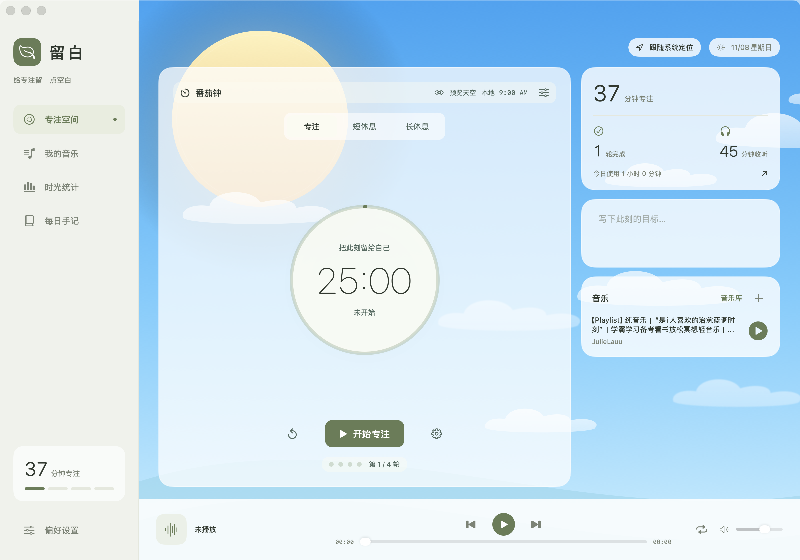
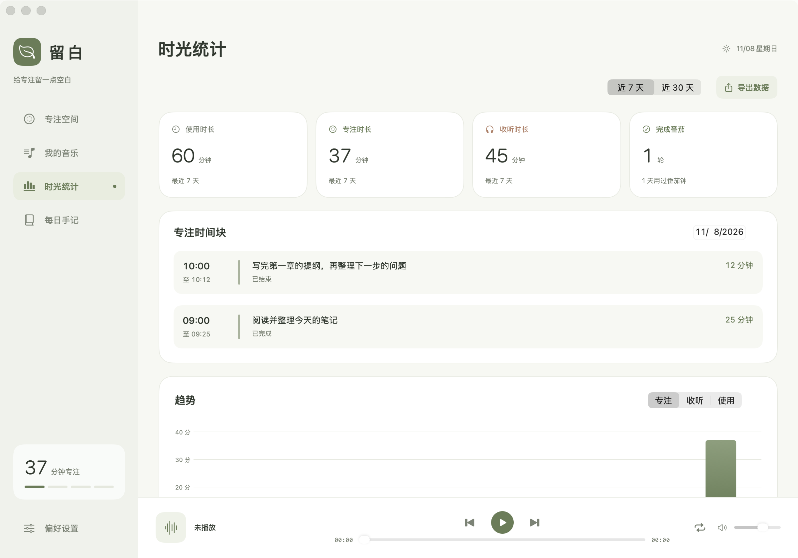
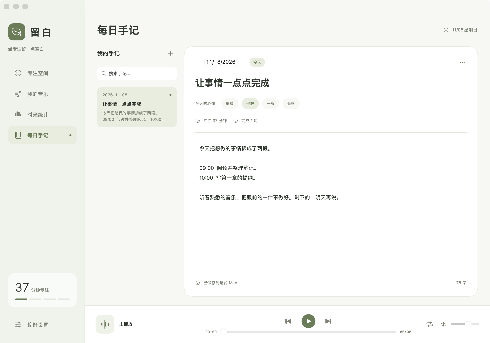
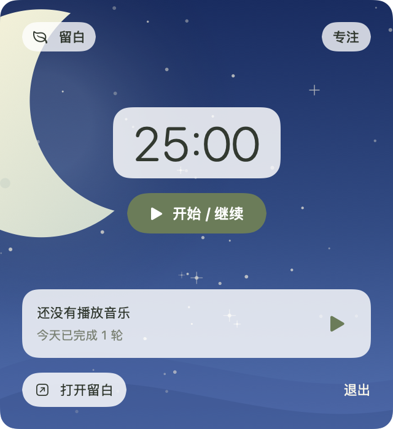

# 留白

[Mac下载](https://github.com/ziruiqiao/liubai/releases/latest) · [更新日志](CHANGELOG.md)

## 初衷
- 想听B站音乐，但不想看视频分心。

## 功能
- B站音乐、合集、收藏夹，在线播放，不下载音乐。
- 番茄钟、目标、统计、手记、自定义心情。
- 动态天空、天气，10套可选主题。
- 菜单栏计时、切歌、主题切换。
- Mac版，M芯片、Intel。
- 佛系开发，全vibe coding。有token就做，没token就鸽。
- 非商用随意改装，发布时保留[来源与许可](LICENSE)。

参考：[wood3n/biu](https://github.com/wood3n/biu)。[上游许可与署名](Notices/README.md)。

菜单栏

